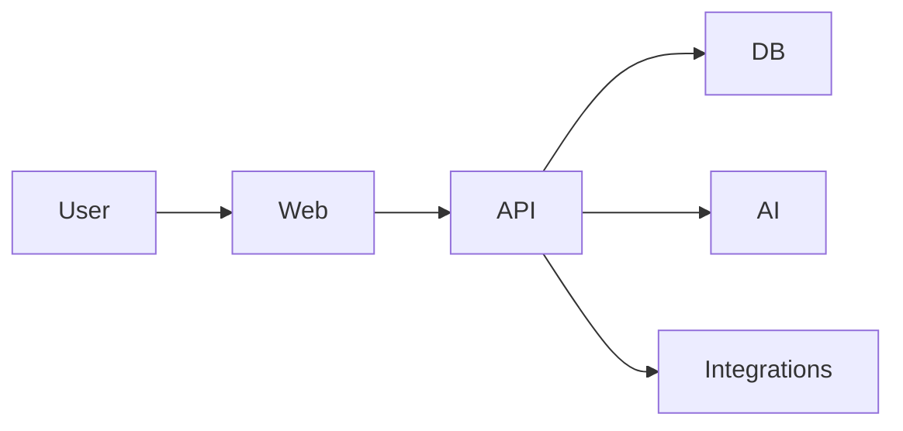

# Architecture

## Principles
- simplest architecture that satisfies current requirements
- explicit boundaries
- typed contracts
- validated external input
- observable critical operations

## Context

## Components
Frontend:
Backend/API:
Domain/application:
Data:
AI:
Integrations:
Workers/queues:
Observability:

## Data flows

## Authentication / authorization

## Tenancy

## Failure modes

## Scalability assumptions

## Technology decisions

## ADR links
