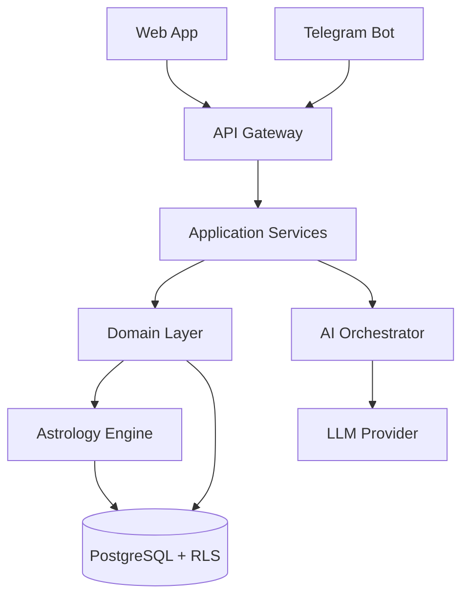

# LUMIRA ARCHITECTURE

## 1. High-Level Architecture
The project follows a modular, layered architecture ensuring the deterministic Astrology Engine remains the source of truth.

## 2. Core Constraints
- **Astrology Engine is Deterministic:** LLM interprets, never calculates.
- **Multi-Tenancy:** Hard isolated via Row-Level Security (RLS) in the Database.
- **AI Abstraction:** LLM providers are interchangeable via `LLMProvider` interface.

## 3. Bounded Contexts
- **Identity:** Users, Tenants, Profiles.
- **Astrology Engine:** Swiss Ephemeris, Natal Chart, Panchanga, Dasha, Transits.
- **Muhurta Engine:** Extensible rules for events scoring.
- **AI Integration:** Chat, Memory, Interpretation, Daily Briefing.
- **Monetization:** Billing, Subscriptions.

## 4. Technology Stack (Proposed)
- **Backend:** Python (FastAPI/Django) - excellent for AI + Swiss Ephemeris (pyswisseph).
- **Database:** PostgreSQL (with strong RLS capabilities).
- **Frontend:** Next.js / React (for premium Web SaaS).
- **Telegram Bot:** aiogram (Python) or Telegraf (Node.js).
- **Infrastructure:** Docker.
